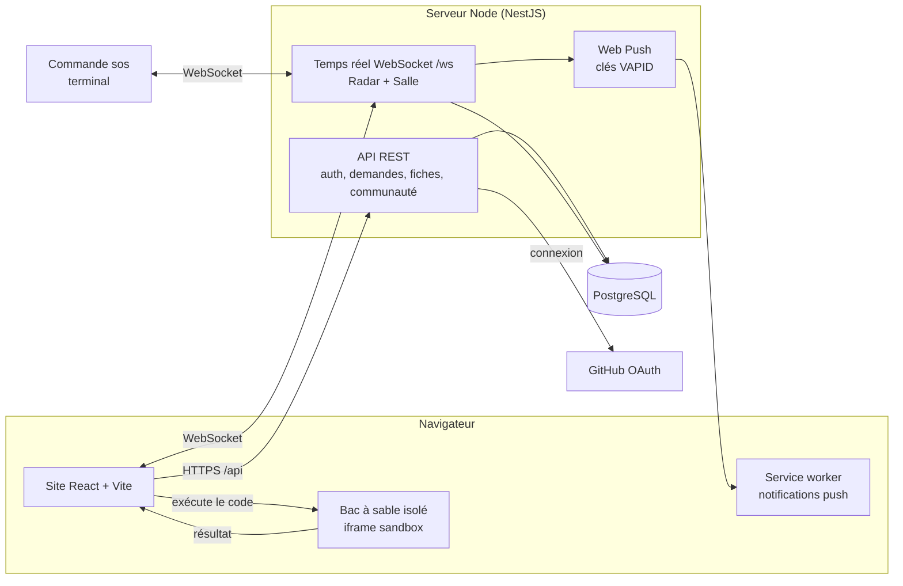
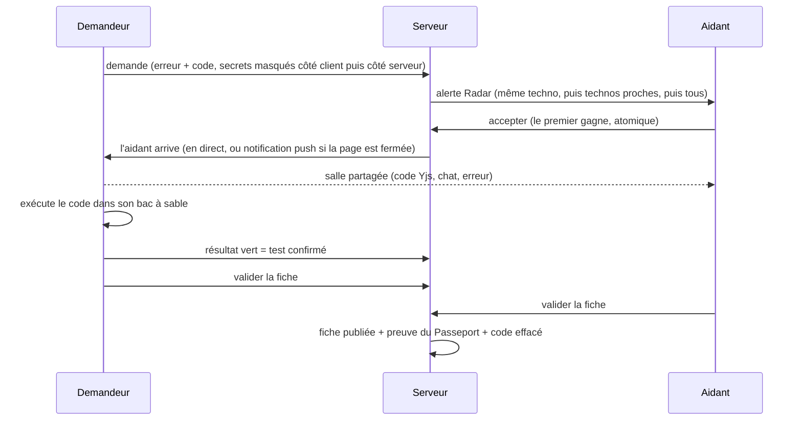

# Architecture de KoraDevs

KoraDevs relie un développeur bloqué à un aidant disponible, dans une salle de code partagée en direct. La solution devient une fiche publique et une preuve dans le Passeport de l'aidant.

## Vue d'ensemble

## Le parcours d'une demande

## Choix qui comptent

| Sujet | Choix | Pourquoi |
|---|---|---|
| Secrets | Masqués dans le navigateur, puis masqués une seconde fois sur le serveur, y compris dans le chat et les résultats d'exécution | Un secret ne doit jamais atteindre un aidant ni une fiche |
| Code du demandeur | Effacé du serveur à la résolution, 24 h au plus | Vie privée |
| Exécution du code | Dans le navigateur, `iframe sandbox="allow-scripts"` sans accès à la page, 5 s maximum. **Le serveur n'exécute jamais de code.** | Aucune surface d'attaque côté serveur |
| Test confirmé | Seul un résultat vert lancé **par le demandeur** compte | L'aidant ne peut pas se confirmer lui-même |
| Passeport | Empreinte SHA-256 d'un JSON canonique, recalculable dans le navigateur, QR code | Preuve vérifiable sans faire confiance au serveur |
| Avant / après | Publié seulement si le demandeur le coche, masqué à nouveau | Consentement explicite |
| Comptes | E-mail + mot de passe (scrypt, sel aléatoire, blocage après 8 essais), GitHub et Google (OAuth, état signé HMAC lié au fournisseur + cookie, jeton rendu dans le fragment d'URL), pseudos uniques | Pas de mot de passe en clair, pas de détournement de connexion |
| Notifications | Web Push, clés VAPID créées une fois et gardées en base | Aucune configuration |
| Stockage | PostgreSQL (migrations versionnées), ou mémoire pour les tests | Données durables en production |
| Licences | Audit automatique, seulement MIT, ISC, Apache, BSD | Règlement du concours, article 6 |

## Tests et qualité

- Tests automatiques du serveur (API, temps réel, magasin de données) sur le stockage mémoire **et** sur un vrai PostgreSQL en CI.
- Vérification de types sur tout le projet, build, audit des licences : exécutés à chaque envoi sur GitHub (`.github/workflows/ci.yml`).
- Test de charge du temps réel : `node scripts/loadtest-ws.mjs <adresse> <paires>`. Mesuré en local avec 25 paires (50 connexions simultanées) : 25 sur 25 réussies, prise de la demande annoncée au demandeur en 113 ms (médiane, p95 181 ms), message de chat reçu en 71 ms (médiane, p95 89 ms).
- Web Push écrit avec le seul module `crypto` de Node (RFC 8291 et VAPID), vérifié contre les bibliothèques de référence `http_ece` et `web-push`. Aucune dépendance livrée avec le serveur n'est sous licence à réciprocité ; seul l'outil de compilation `lightningcss` (MPL-2.0, utilisé par Vite, non livré) l'est, et il est déclaré.

## Lancer

Voir le `README.md`.
